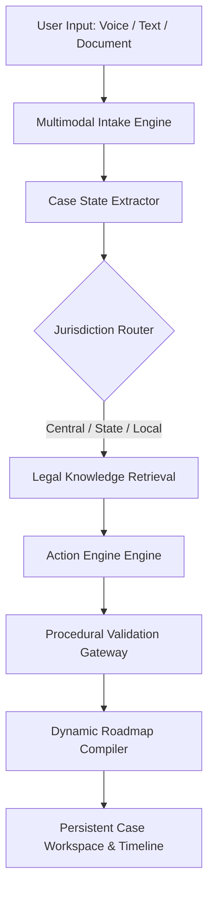
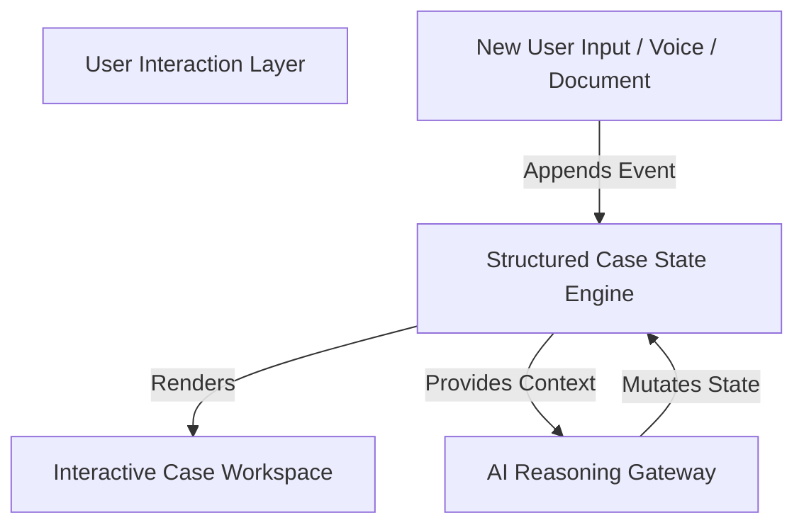
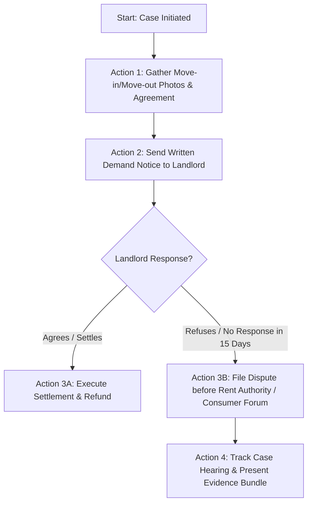
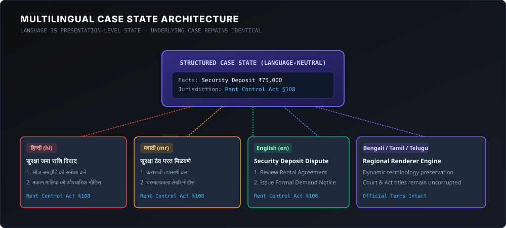
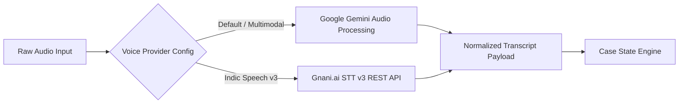
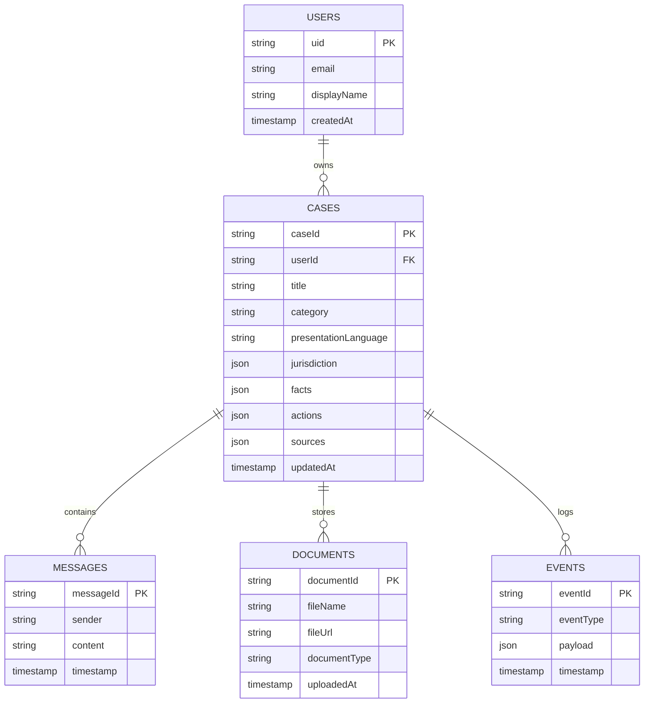
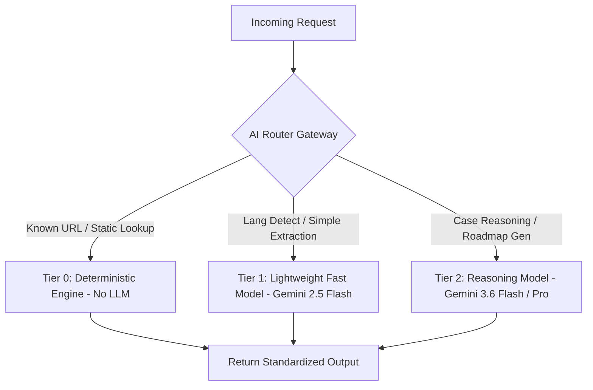
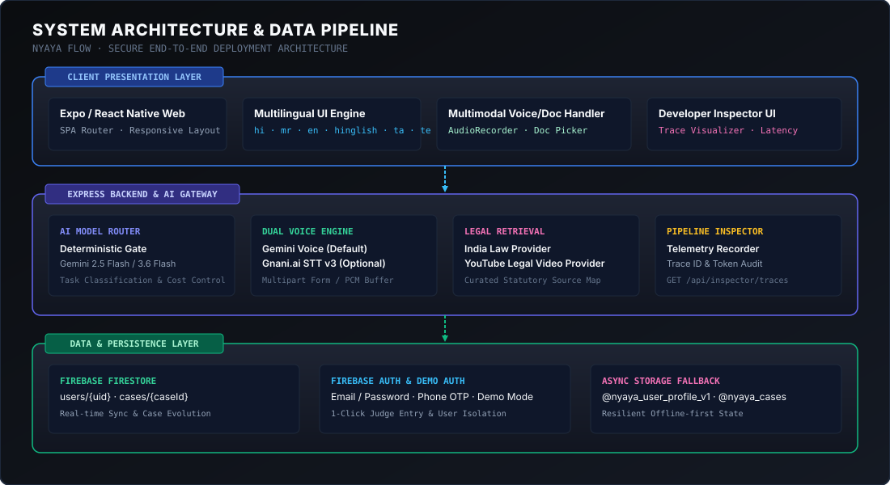
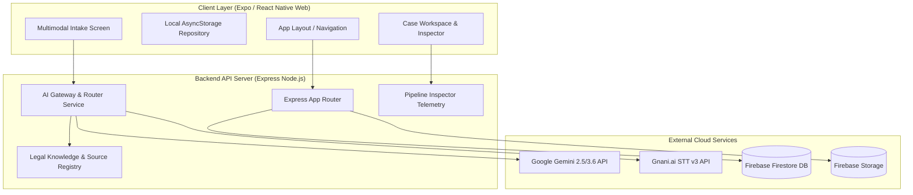

# Nyaya Flow

### Know your rights. Know your next step.

**AI Legal Navigation System for India**

> Nyaya Flow helps people turn a real-world legal or government problem into a structured, source-backed path of action, in the language they understand.

[](https://shubhrgunjan.github.io/nyaya-flow/)
[](https://github.com/shubhrgunjan/nyaya-flow)
[](https://www.typescriptlang.org/)
[](https://reactnative.dev/)
[](https://expo.dev/)
[](https://firebase.google.com/)
[](https://ai.google.dev/)
[](https://www.gnani.ai/)

---


*Caption: From a real-world problem to the next actionable step.*

---

## Table of Contents

- [The Problem](#the-problem)
- [Real-World Context](#real-world-context)
- [What is Nyaya Flow?](#what-is-nyaya-flow)
- [Core Product Flow](#core-product-flow)
- [Key Innovation #1: Case-First AI](#key-innovation-1-case-first-ai)
- [Key Innovation #2: Action Engine](#key-innovation-2-action-engine)
- [Key Innovation #3: Dynamic Procedural Roadmap](#key-innovation-3-dynamic-procedural-roadmap)
- [Key Innovation #4: Multilingual Legal Navigation](#key-innovation-4-multilingual-legal-navigation)
- [Key Innovation #5: Multimodal Intake](#key-innovation-5-multimodal-intake)
- [Gnani.ai + Gemini Voice Architecture](#gnaniai--gemini-voice-architecture)
- [Legal Retrieval & Source Provenance](#legal-retrieval--source-provenance)
- [Jurisdiction Engine](#jurisdiction-engine)
- [Case State Engine](#case-state-engine)
- [Data Model](#data-model)
- [Event & Version History](#event--version-history)
- [AI Model Routing](#ai-model-routing)
- [System Architecture](#system-architecture)
- [Security & Privacy](#security--privacy)
- [Developer Pipeline Inspector](#developer-pipeline-inspector)
- [Example Case: Rental Security Deposit Dispute](#example-case-rental-security-deposit-dispute)
- [Why Not Just ChatGPT or Gemini?](#why-not-just-chatgpt-or-gemini)
- [Responsible AI](#responsible-ai)
- [Technology Stack](#technology-stack)
- [Project Structure](#project-structure)
- [Getting Started](#getting-started)
- [Environment Variables](#environment-variables)
- [Deployment](#deployment)
- [Current Status](#current-status)
- [Future Direction](#future-direction)
- [Limitations & Conclusion](#limitations--conclusion)

---

## The Problem

In India, accessing legal recourse or government grievance procedures presents a severe structural challenge for everyday citizens. When a citizen encounters a legal dispute—such as a withheld rental deposit, a consumer breach, a delayed government service, or workplace wage theft—they are immediately confronted by an overwhelming procedural barrier.

The fundamental issue is not merely that legal information is complex; it is the massive gap between **Legal Information** and **Legal Action**.

```
Problem Occurs
      │
      ▼
 Which Law Applies?
      │
      ▼
 Which Authority has Jurisdiction?
      │
      ▼
 Which Forum / Portal / Department?
      │
      ▼
 Which Documents & Evidence are Required?
      │
      ▼
 What is the Exact Step-by-Step Procedure?
      │
      ▼
 What are the Statutory Deadlines?
      │
      ▼
 What if the First Step Fails or is Ignored?
```

People do not begin their legal journey with statutory citations or section numbers. They begin with a human experience:
> *"My landlord deducted ₹20,000 from my deposit without receipts and stopped answering my calls."*  
> *"The municipal authority hasn't issued my trade license after 90 days despite full payment."*

Generic AI tools respond to these statements with long essays, listing dozens of legal sections, rights, and hypothetical remedies. However, an unorganized list of laws leaves the user paralyzed, unable to determine what to actually **do next**, where to submit evidence, or how to enforce their rights within their specific district or state jurisdiction.

---

## Real-World Context

The necessity for source-grounded, procedurally guided legal navigation is underscored by real-world judicial precedents, legislative reforms, and administrative realities across India:

1. **Linguistic and Procedural Exclusion (*Prakash Nishad v. State of Maharashtra, 2023*)**: Citizens routinely miss critical statutory limitation periods or file before incorrect administrative bodies due to procedural complexity and language barriers between state official proceedings and regional dialects.
2. **Access to Justice as a Fundamental Right (*Hussainara Khatoon v. Home Secretary, State of Bihar, 1979*)**: The Supreme Court established that meaningful access to legal aid and procedural awareness is an integral component of Right to Life under Article 21 of the Constitution of India.
3. **Supreme Court Translation & Accessibility Initiatives**: Initiatives such as SUVAS (Supreme Court Vidhik Anuvaad Software) and the Supreme Court's Landmark Judgment Summaries highlight the urgent national drive to make judicial outcomes accessible in regional languages.
4. **Judicial Warnings on Hallucinated AI Citations**: Courts across jurisdictions have repeatedly penalized pleadings containing fabricated legal citations generated by ungrounded LLMs. This underscores why AI used for legal assistance **must never be an ungrounded text generator**, but must operate strictly within a source-verified retrieval layer.

---

## What is Nyaya Flow?

Nyaya Flow is **not** an "AI Lawyer," **not** a generic conversational chatbot, **not** a legal search engine, and **not** a document summarizer.

Positioned precisely, Nyaya Flow is an **AI Legal Navigation System for India**.

It transforms unstructured citizen grievances into structured, source-backed, step-by-step action plans:

```
UNSTRUCTURED GRIEVANCE
       │
       ▼
 [ CASE UNDERSTANDING ] ── Extract Facts, Entities, Amounts, Dates
       │
       ▼
 [ JURISDICTION ENGINE ] ── Identify State/Central Jurisdiction & Forum
       │
       ▼
 [ LEGAL RETRIEVAL ]    ── Retrieve Verified Official Laws & Portals
       │
       ▼
 [ ACTION ENGINE ]      ── Synthesize Branching Action Roadmap
       │
       ▼
 [ EVIDENCE MAPPING ]   ── Connect Required Proof to Action Items
       │
       ▼
 EXECUTABLE CASE WORKSPACE
```

---

## Core Product Flow

Nyaya Flow decomposes case processing into discrete deterministic and LLM-assisted execution phases:



### Execution Steps
1. **Intake**: Accepts voice (via Gemini or Gnani.ai STT v3), text descriptions, or uploaded documents/receipts.
2. **Extraction**: Normalizes input into structured facts, missing details, dates, financial amounts, and claims.
3. **Jurisdiction Routing**: Evaluates geographic and subject-matter rules (e.g., Central RTI Online vs. State RTI portal, District Consumer Commission vs. RERA).
4. **Legal Retrieval**: Queries the legal source registry to ground every step in official statutes, rules, and government portals.
5. **Action Generation**: Produces prioritized, dependency-linked action items with clear completion criteria.
6. **Validation**: Verifies that every recommended action has an attached official source and clear evidence requirements.
7. **Workspace Compilation**: Renders a live, interactive case state with evidence checklists and multilingual views.

---

## Key Innovation #1: Case-First AI

Most AI legal assistants follow a **Chat-First Paradigm**:

```
Question ──► LLM ──► Answer ──► (Conversation History Overhead / Context Loss)
```

In a chat-first approach, as the conversation progresses, facts get buried in transcript tokens, leading to context drift, repetition, and hallucinations.

Nyaya Flow adopts a **Case-First Paradigm**:



### Why Structured Case State is Superior
* **State vs. Transcript**: The chat transcript is merely an event stream. The **Structured Case State** (`CaseState`) is the single source of truth.
* **Deterministic Evolution**: When a user uploads a receipt or provides a date, it updates explicit attributes (`facts`, `evidence`, `actions`), rather than re-prompting the model with historical chat logs.
* **Resilience**: The case state persists independently across sessions, browser reloads, and mobile devices without relying on prompt memory.

---

## Key Innovation #2: Action Engine

The core philosophy of Nyaya Flow is that **answers do not resolve disputes—actions do**. The Action Engine generates concrete, executable `ActionItem` objects rather than generic text advice.

### Conceptual Structure of an Action Item

```typescript
interface ActionItem {
  id: string;
  order: number;
  title: string;
  description: string;
  why: string;                           // Legal/procedural justification
  priority: 'CRITICAL' | 'HIGH' | 'MEDIUM' | 'LOW';
  status: 'PENDING' | 'IN_PROGRESS' | 'COMPLETED' | 'BLOCKED';
  evidenceRequired: EvidenceRequirement[]; // Specific documents/proof needed
  documentsRequired: DocumentTemplate[];   // Forms/notices to draft
  source: LegalSource;                     // Citation & official URL
  deadline?: StatutoryDeadline;            // Limitation periods / response SLAs
  dependency?: string[];                  // Action IDs that must precede this
  completionCriteria: string;             // Exact condition for completion
}
```

```
[ FACT EXTRACTED ] ──► [ LEGAL ROUTE ] ──► [ ACTION GENERATED ] ──► [ EVIDENCE LINKED ] ──► [ SOURCE ATTACHED ]
```

---

## Key Innovation #3: Dynamic Procedural Roadmap

Legal remedies are rarely linear checklists; they are decision trees with dependencies, parallel steps, and alternative routes.



### Roadmap Characteristics
* **Dependency Resolution**: Action items specify prerequisite actions before unlocking subsequent stages.
* **Branching & Escalation**: If an informal demand notice fails within a statutory window (e.g., 15 days), the roadmap dynamically opens formal litigation or tribunal pathways.
* **Variable Scope**: Roadmaps adapt dynamically to case complexity, producing anywhere from 2 simple steps to 8+ multi-tier procedural actions.

---

## Key Innovation #4: Multilingual Legal Navigation

In India, legal proceedings occur in English and state official languages, while citizens communicate in regional languages and local dialects.

Nyaya Flow treats language as a **Presentation-Layer Render State**, keeping the underlying case model **Language-Neutral**.



### Key Multilingual Principles
1. **Zero State Loss on Language Switch**: Switching presentation language between Hindi, Marathi, and English re-renders UI components instantly from the same underlying `CaseState`.
2. **Preservation of Official Legal Terminology**: While narrative descriptions adapt to the user's selected language, official legal identifiers remain anchored in their legal forms:
   * **Acts & Statutes**: *Consumer Protection Act, 2019*, *Section 138 of Negotiable Instruments Act*
   * **Institutions**: *District Consumer Disputes Redressal Commission*, *RERA Authority*
   * **Identifiers**: CNR Numbers, RTI Application Numbers, Official Portal URLs (`rtionline.gov.in`, `e-courts.gov.in`).

---

## Key Innovation #5: Multimodal Intake

Citizens rarely possess cleanly structured legal briefs. Nyaya Flow accepts unstructured inputs across multiple mediums and normalizes them into unified case facts:

```
 🎤 Voice Input   ──► [ STT Normalization (Gemini / Gnani.ai) ] ┐
 📝 Text Input    ──► [ Fact & Entity Extraction ]              ├──► [ Unified Case State ]
 📄 PDF Document  ──► [ Document Parser & OCR ]                  │
 📷 Receipt Photo ──► [ Visual Evidence Analyzer ]               ┘
```

* **Voice**: Supports spoken narratives in regional languages for non-literate or mobile-first users.
* **Documents**: Extracts key metadata from lease agreements, notices, invoices, and bank statements (parties, dates, financial amounts, penalty clauses).
* **Images**: Analyzes photographs of physical damage, move-in checklists, or handwritten receipts as evidence artifacts.

---

## Gnani.ai + Gemini Voice Architecture

Nyaya Flow implements a modular dual-provider voice transcription architecture designed for resilience and regional speech accuracy:



### Voice Pipeline Design
* **Default Provider**: Google Gemini handles audio transcription and initial intent extraction natively in a single multi-modal inference pass.
* **Gnani.ai Integration**: Connected via server-side proxy (`POST /api/ai/transcribe-audio`) utilizing Gnani.ai STT v3 API (`https://api.vachana.ai/stt/v3`) for high-fidelity Indic accent recognition.
* **Zero API Key Exposure**: All third-party STT tokens and API keys are strictly confined to the backend server (`server/src/routes/ai.ts`).

---

## Legal Retrieval & Source Provenance

To mitigate hallucination risks inherent in LLMs, Nyaya Flow enforces a strict **Source Provenance Policy**.

```
                           [ LEGAL SOURCE HIERARCHY ]
                                       │
      ┌────────────────────────────────┼────────────────────────────────┐
      ▼                                ▼                                ▼
[ PRIMARY SOURCES ]          [ INSTITUTIONAL SOURCES ]       [ SECONDARY GUIDANCE ]
• Official Acts & Statutes   • NALSA / DSLSA Legal Aid       • Verified Explanatory Guides
• Govt Gazette Notices       • Official Citizen Portals      • Procedural Manuals
• High Court / SC Rulings    • e-Courts & RTI Services       • FAQ Documentation
```

### Provenance Linkage
Every recommended action, limitation period, or jurisdiction assignment must include a verified `LegalSource` reference:

```json
{
  "sourceId": "src_consumer_act_2019_s35",
  "title": "Consumer Protection Act, 2019 - Section 35",
  "authority": "Parliament of India",
  "url": "https://consumeraffairs.nic.in/",
  "type": "STATUTE",
  "provenanceConfidence": 0.98
}
```

> **Hallucination Risk Reduction**: Nyaya Flow never presents generated text as authoritative law. Procedural rules are grounded against retrieved legal assets, explicitly distinguishing between advice and statute.

---

## Jurisdiction Engine

Filing a dispute in the wrong forum results in immediate dismissal or months of administrative delay. The Jurisdiction Engine routes cases based on statutory territorial, pecuniary, and subject-matter rules:

```
                       GRIEVANCE ANALYSIS
                               │
               ┌───────────────┴───────────────┐
               ▼                               ▼
       [ SUBJECT MATTER ]             [ PECUNIARY VALUE ]
      • Tenant Dispute               • Claim < ₹50 Lakhs ──► District Forum
      • RTI Non-compliance           • Claim > ₹50 Lakhs ──► State Forum
      • Service Deficiency                     │
               │                               │
               └───────────────┬───────────────┘
                               ▼
                    [ JURISDICTION DETERMINATION ]
                    • Authority: District Consumer Commission / Rent Tribunal
                    • Forum URL: edaakhil.nic.in
                    • Governing Act: Consumer Protection Act, 2019
```

### Concrete Jurisdiction Routing Example: Right to Information (RTI)
* **Central Government Public Authority** (e.g., Income Tax Dept, Passport Office) ──► Routed to **Central RTI Online Portal (`rtionline.gov.in`)**.
* **State Government Public Authority** (e.g., State Police, Municipal Corporation) ──► Routed to respective **State RTI Portal or Designated State PIO**.

---

## Case State Engine

The complete lifecycle of a dispute is encapsulated in the `CaseState` domain object (`src/domain/case/types.ts`):

```typescript
export interface CaseState {
  id: string;
  userId: string;
  title: string;
  category: CaseCategory;       // RENT, CONSUMER, RTI, WORKPLACE, CIVIC
  jurisdiction: Jurisdiction;   // Authority, Level, Forum, State/Central
  facts: FactItem[];            // Extracted verified facts
  entities: EntityItem[];       // Landlord, Employer, Vendor, Authority
  dates: DateFact[];            // Key dates (Incident, Notice, Agreement)
  financials: FinancialItem[];  // Claim amounts, deposits, deductions
  documents: DocumentItem[];    // Uploaded PDFs, images, receipts
  evidence: EvidenceItem[];     // Evaluated proof (Photos, Chats, Invoices)
  missingInfo: MissingInfo[];   // Required facts user needs to provide
  riskFlags: RiskFlag[];        // Limitation period warnings, fraud risks
  recommendedRoute: LegalRoute; // Selected procedural route
  actions: ActionItem[];        // Generated procedural roadmap
  sources: LegalSource[];       // Verified primary legal references
  timeline: CaseEvent[];        // Full historical event log
  updatedAt: string;
}
```

---

## Data Model

Nyaya Flow uses Google Cloud Firestore for real-time document synchronization and persistence.



---

## Event & Version History

To preserve an immutable audit record, all state mutations append a typed event to the case timeline:

| Event Type | Trigger Description |
| :--- | :--- |
| `CASE_CREATED` | Case initialized via initial intake prompt or voice stream |
| `FACT_ADDED` | New fact extracted from user response or document OCR |
| `DOCUMENT_ATTACHED` | User uploads agreement, notice copy, or receipt PDF |
| `EVIDENCE_ADDED` | Uploaded document linked to a specific `ActionItem` requirement |
| `ROADMAP_UPDATED` | Action Engine recalculates actions following new user inputs |
| `ACTION_COMPLETED` | User fulfills completion criteria for a roadmap step |
| `DEADLINE_ADDED` | Statutory limitation clock initiated for a legal remedy |

---

## AI Model Routing

To optimize latency, cost, and output precision, Nyaya Flow implements a **Multi-Tier AI Routing Strategy**:



### Routing Logic Matrix

| Tier | Complexity Level | Model / Technology | Target Operation | Token Cost |
| :--- | :--- | :--- | :--- | :--- |
| **Tier 0** | Deterministic | Hardcoded Rules / Regex | Portal URL lookups, progress calculations, status shifts | **$0.00** |
| **Tier 1** | Low | Gemini 2.5 Flash | Language detection, entity extraction, categorization | Very Low |
| **Tier 2** | High | Gemini 3.6 Flash / Pro | Deep legal reasoning, jurisdiction conflict resolution, multi-step roadmap compilation | Standard |

---

## System Architecture

Nyaya Flow employs a 3-tier architecture with full client-server isolation:





---

## Security & Privacy

Nyaya Flow incorporates rigorous security patterns to safeguard sensitive citizen data:

1. **Zero Client Secrets**: All API credentials (`GEMINI_API_KEY`, `GNANI_API_KEY`, Firebase Admin Service Account Keys) reside exclusively in backend environment variables.
2. **User-Scoped Firestore Security Rules**: Firestore rules (`firestore.rules`) enforce strict authorization bounds:
   ```javascript
   match /users/{userId} {
     allow read, write: if request.auth != null && request.auth.uid == userId;
   }
   match /cases/{caseId} {
     allow read, write: if request.auth != null && resource.data.userId == request.auth.uid;
   }
   ```
3. **Authentication Isolation**: Supports Firebase Authentication (Email/Password, Anonymous Demo Mode). Client requests carry verified Firebase ID Bearer Tokens.
4. **Sanitized Telemetry**: The Developer Pipeline Inspector redacts sensitive personal identifiers (PII) before storing trace logs.

---

## Developer Pipeline Inspector

For debugging, latency optimization, and AI transparency, Nyaya Flow includes an embedded **Developer Pipeline Inspector** (`app/inspector.tsx`):

```
┌────────────────────────────────────────────────────────────────────────┐
│ DEVELOPER PIPELINE INSPECTOR                     Trace #NF-83A1-2026   │
├────────────────────────────────────────────────────────────────────────┤
│ INPUT: "मेरे मकान मालिक ने ₹75,000 डिपॉज़िट वापस करने से मना कर दिया..."   │
│ PROVIDER: Gnani.ai STT v3  │  LATENCY: 412ms  │  TOKENS: 142 In / 89 Out│
├────────────────────────────────────────────────────────────────────────┤
│ PROCESSING STAGES:                                                     │
│ ├─ [✓] STT Normalization         ──► Lang: hi-IN                       │
│ ├─ [✓] Fact Extraction           ──► Amount: ₹75,000, Category: RENT   │
│ ├─ [✓] Jurisdiction Router       ──► Forum: District Rent Authority    │
│ ├─ [✓] Legal Retrieval           ──► Matched: Rent Control Act Sec 14  │
│ ├─ [✓] Action Engine             ──► Generated 4 Prioritized Actions   │
│ └─ [✓] Validation Gateway        ──► Sources Verified (100% Grounded)  │
└────────────────────────────────────────────────────────────────────────┘
```

The inspector exposes model selection, prompt execution time, token counts, system prompts, raw JSON payloads, and source confidence scoring for full developer observability.

---

## Example Case: Rental Security Deposit Dispute

### 1. Raw User Input (Hindi Voice Narrative)
> *"मेरे मकान मालिक ने मेरा ₹75,000 का सिक्योरिटी डिपॉज़िट वापस नहीं किया। एग्रीमेंट में लिखा है कि 30 दिन में वापस करना है। उसने WhatsApp पर कहा है कि ₹20,000 painting charges के लिए काटेगा। मेरे पास move-in और move-out की photos हैं।"*

### 2. Extracted Case Facts & Entities
* **Dispute Type**: Rental Security Deposit Breach
* **Financial Value**: Claimed Amount ₹75,000 | Disputed Deduction ₹20,000
* **Key Dates**: Move-out Date (Recorded), Agreement Refund Window (30 Days)
* **Available Evidence**: Lease Agreement, WhatsApp Chat Export, Move-in/Move-out Photographs
* **Jurisdiction**: Rent Control Court / District Consumer Disputes Redressal Commission

### 3. Generated Action Roadmap

```
[ STEP 1: COMPILE EVIDENCE BUNDLE ]  (Priority: HIGH | Status: PENDING)
├─ Description: Organize lease agreement, WhatsApp chat screenshots, and timestamped photos.
├─ Required Documents: Agreement PDF, Photos, Deduction Notice.
└─ Statutory Source: Indian Evidence Act, Section 65B (Electronic Records).

[ STEP 2: ISSUE FORMAL DEMAND NOTICE ]  (Priority: CRITICAL | Status: PENDING)
├─ Description: Send registered legal notice demanding full refund within 15 statutory days.
├─ Target Recipient: Landlord (Name & Address recorded).
└─ Source: Model Tenancy Framework / State Rent Control Act.

[ STEP 3: FILE CONSUMER / RENT DISPUTE ]  (Priority: HIGH | Status: BLOCKED by Step 2)
├─ Description: Submit grievance on e-Daakhil consumer portal if notice expires without refund.
├─ Forum: District Consumer Disputes Redressal Commission.
└─ Official Portal URL: https://edaakhil.nic.in/
```

---

## Why Not Just ChatGPT or Gemini?

| Feature / Capability | Generic AI Chatbot (ChatGPT / Gemini) | Nyaya Flow AI Legal Navigation System |
| :--- | :--- | :--- |
| **Interaction Model** | Open-ended conversational chat | **Structured Case State Workspace** |
| **Output Type** | Long text essays & statutory lists | **Executable Step-by-Step Action Roadmap** |
| **Evidence Handling** | Mentions evidence in passing | **Directly links proof artifacts to required steps** |
| **Jurisdiction Precision** | Frequently mixes state vs central rules | **Strict Jurisdiction Engine (Central/State/District)** |
| **Language Persistence** | Translates text per message | **Language-neutral state with localized presentation** |
| **Source Provenance** | Unverified citations (Hallucination risk) | **Grounded Primary & Institutional Legal Sources** |
| **Persistence** | Lost in chat window history | **Persistent Firestore DB & Versioned Audit Trail** |

---

## Responsible AI

Nyaya Flow is built strictly in accordance with ethical AI guidelines:

* **Non-Legal Advice Disclaimer**: Nyaya Flow is an informational legal navigation platform, not a licensed legal practitioner. It does not create an attorney-client relationship.
* **Uncertainty Communication**: When critical details are missing (e.g., exact state jurisdiction or contract dates), the system explicitly prompts the user to supply the missing information before generating formal actions.
* **Legal Aid Forwarding**: For indigent litigants or complex criminal/matrimonial matters, Nyaya Flow explicitly provides referral information for National Legal Services Authority (NALSA) and State Legal Services Authorities (SLSA).

---

## Technology Stack

```
┌────────────────────────────────────────────────────────────────────────┐
│                           TECHNOLOGY STACK                             │
├─────────────────┬──────────────────────────────────────────────────────┤
│ Frontend Core   │ React Native Web, Expo (v57), TypeScript, Expo Router│
├─────────────────┼──────────────────────────────────────────────────────┤
│ Backend Server  │ Node.js, Express, TypeScript                         │
├─────────────────┼──────────────────────────────────────────────────────┤
│ AI Framework    │ Google Gemini 2.5 / 3.6 Flash (Server-Side SDK)      │
├─────────────────┼──────────────────────────────────────────────────────┤
│ Voice & Speech  │ Gnani.ai STT v3 REST API, Gemini Audio Processing    │
├─────────────────┼──────────────────────────────────────────────────────┤
│ Database        │ Firebase Firestore (Real-time Sync & Collections)    │
├─────────────────┼──────────────────────────────────────────────────────┤
│ Auth & Storage  │ Firebase Authentication, Firebase Storage            │
├─────────────────┼──────────────────────────────────────────────────────┤
│ Deployment      │ GitHub Pages (Web Client SPA), Vercel / Render       │
└─────────────────┴──────────────────────────────────────────────────────┘
```

---

## Project Structure

```
nyaya-flow/
├── app/                        # Expo Router Navigation & Screens
│   ├── (tabs)/                 # Main Bottom Tab Screens (Home, Cases, Profile)
│   ├── case/                   # Case Workspace & Details Router
│   ├── intake.tsx              # Multimodal Case Intake Screen
│   ├── inspector.tsx           # Developer Pipeline Inspector
│   ├── scanner.tsx             # Document OCR & Photo Capture Screen
│   ├── landing.tsx             # Web Landing Page
│   └── _layout.tsx             # Root Provider & Navigation Layout
├── assets/                     # Graphics, Icons, SVGs & Readme Visuals
│   └── readme/                 # Architectural SVG Visuals for README
├── server/                     # Backend API Application
│   ├── src/
│   │   ├── ai/                 # Gemini & Gnani AI Gateway Adapters
│   │   ├── legal/              # Legal Source Registry & Knowledge Layer
│   │   ├── middleware/         # Auth & Rate Limiting Middleware
│   │   ├── routes/             # Express API Routes (/api/ai, /api/inspector)
│   │   ├── config.ts           # Server Configuration & Env Validation
│   │   └── index.ts            # Server Entry Point
│   └── package.json            # Server Dependencies & Scripts
├── src/                        # Core Application Source & Shared Libraries
│   ├── components/             # Reusable UI Components (Cards, Buttons, Modals)
│   ├── context/                # React Context Providers (Auth, Theme, Language)
│   ├── domain/                 # Core Domain Types (CaseState, ActionItem, Source)
│   ├── hooks/                  # Custom React Hooks (useCase, useSpeech)
│   ├── i18n/                   # Multilingual Translation Dictionaries
│   ├── lib/                    # Firebase Client Setup & Storage Utilities
│   └── services/               # Frontend API Clients & Services
├── firestore.rules             # Production Firebase Firestore Security Rules
├── storage.rules               # Production Firebase Storage Security Rules
├── firebase.json               # Firebase Project Deployment Spec
├── vercel.json                 # Vercel Deployment Spec for Backend Server
└── package.json                # Frontend Workspace Dependencies & Scripts
```

---

## Getting Started

### Prerequisites
* **Node.js**: `v18.x` or `v20.x` installed
* **npm**: `v9.x` or higher
* **Git**: Installed

### Installation

1. **Clone the Repository**:
   ```bash
   git clone https://github.com/shubhrgunjan/nyaya-flow.git
   cd nyaya-flow
   ```

2. **Install Frontend Dependencies**:
   ```bash
   npm install
   ```

3. **Install Backend Server Dependencies**:
   ```bash
   cd server
   npm install
   cd ..
   ```

4. **Configure Environment Variables**:
   Create a `.env` file in the `server` directory (refer to [Environment Variables](#environment-variables)).

5. **Start Development Servers**:
   * **Start Backend Server**:
     ```bash
     cd server
     npm run dev
     ```
   * **Start Web / Mobile Frontend** (in a separate terminal):
     ```bash
     npm run web
     ```

6. Open your browser to `http://localhost:8081` to view the Nyaya Flow application.

---

## Environment Variables

### Server Configuration (`server/.env`)

| Variable | Description | Scope | Required |
| :--- | :--- | :--- | :--- |
| `PORT` | Backend HTTP Server Port (Default: `3001`) | Server-Only | Yes |
| `GEMINI_API_KEY` | Google Gemini API Key for Case Reasoning & STT | Server-Only | Yes |
| `GNANI_API_KEY` | Gnani.ai STT v3 Authentication Token | Server-Only | Optional |
| `FIREBASE_PROJECT_ID` | Firebase Project Identifier | Server-Only | Yes |
| `FIREBASE_CLIENT_EMAIL` | Firebase Service Account Client Email | Server-Only | Yes |
| `FIREBASE_PRIVATE_KEY` | Firebase Service Account RSA Private Key | Server-Only | Yes |

### Client Configuration (`.env`)

| Variable | Description | Scope | Required |
| :--- | :--- | :--- | :--- |
| `EXPO_PUBLIC_API_URL` | Backend Server Base API URL (`http://localhost:3001`) | Client-Safe | Yes |
| `EXPO_PUBLIC_FIREBASE_API_KEY` | Firebase Web API Key | Client-Safe | Yes |
| `EXPO_PUBLIC_FIREBASE_AUTH_DOMAIN` | Firebase Authentication Domain | Client-Safe | Yes |
| `EXPO_PUBLIC_FIREBASE_PROJECT_ID` | Firebase Project Identifier | Client-Safe | Yes |

---

## Deployment

### Live Web Demo Deployment (GitHub Pages)

The web bundle is compiled to static assets and deployed to GitHub Pages (`gh-pages` branch):

```bash
# Export static web bundle
npx expo export --platform web

# Deploy to GitHub Pages
npx gh-pages -d dist -r https://github.com/shubhrgunjan/nyaya-flow.git
```

* **Live Demo URL**: [https://shubhrgunjan.github.io/nyaya-flow/](https://shubhrgunjan.github.io/nyaya-flow/)

### Backend Server Deployment (Vercel / Render / GCP Cloud Run)

The server component (`server/`) is pre-configured for Vercel or Render deployment using `vercel.json` and standard Node.js build scripts.

---

## Current Status

```
┌────────────────────────────────────────────────────────────────────────┐
│                        IMPLEMENTATION MATRIX                           │
├──────────────────────────────────────┬─────────────────────────────────┤
│ Capability                           │ Implementation Status           │
├──────────────────────────────────────┼─────────────────────────────────┤
│ Multimodal Case Intake (Voice/Text)  │ [✓] Built & Integrated          │
│ Structured Case State Extraction     │ [✓] Built & Integrated          │
│ Action Engine & Procedural Roadmap   │ [✓] Built & Integrated          │
│ Multilingual Engine (HI, MR, EN)     │ [✓] Built & Integrated          │
│ Dual Voice Engine (Gemini / Gnani)   │ [✓] Built & Integrated          │
│ Firestore DB Persistence             │ [✓] Built & Integrated          │
│ Developer Pipeline Inspector         │ [✓] Built & Integrated          │
│ Source Provenance Registry           │ [✓] Built & Integrated          │
│ Real-time e-Courts Live Sync         │ [ ] Planned (Future Direction)  │
│ Automated Notice Drafting Export     │ [ ] Planned (Future Direction)  │
└──────────────────────────────────────┴─────────────────────────────────┘
```

---

## Future Direction

1. **Expanded Indic Language Coverage**: Extending speech recognition and rendering to Tamil, Telugu, Bengali, Kannada, and Gujarati.
2. **e-Courts & Official API Integrations**: Directly connecting case numbers to e-Courts APIs to track hearing schedules automatically within the user's roadmap.
3. **Automated Document Generation**: Allowing users to generate pre-filled legal notice PDFs directly from verified case state parameters.
4. **Legal Aid Portal Handoff**: One-click referral dispatch to NALSA/DSLSA advocate portals for qualified low-income citizens.

---

## Limitations & Conclusion

Nyaya Flow bridge the critical gap between passive legal information and structured, executable legal action for Indian citizens. By replacing generic chat interactions with a source-grounded Case State Engine, dynamic action roadmaps, and Indic language accessibility, Nyaya Flow empowers citizens to navigate legal challenges with clarity, structure, and confidence.

---

*Nyaya Flow — Know your rights. Know your next step.*
